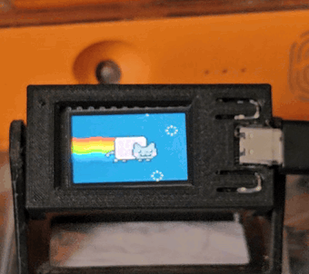

**🇺🇸 English** | [🇧🇷 Português](README.pt-br.md)

# GIF Display — TTGO T-Display ESP32

A **standalone, network-configurable GIF player** for the **LILYGO/TTGO
T-Display ESP32** board (1.14" 135×240, ST7789). GIFs live in the ESP32's
internal flash and loop on screen; you manage everything through a **built-in
web interface** served by the board itself, or through a **desktop app**
(GUI + CLI) that also **resizes GIFs before uploading**.

<p align="center">
  
</p>

## Features

- ▶️ Plays animated GIFs straight from flash (LittleFS), streamed frame by frame.
- 📶 WiFi setup via **captive portal** (no credentials in the code).
- 🌐 Built-in **web UI** (`http://gifdisplay.local`): upload, delete, switch
  and configure — no recompiling.
- 💻 **Desktop app** ([tools/esp32gif](tools/esp32gif)): GUI + CLI that
  **resizes the GIF** (Pillow) to the screen before sending.
- 🔆 Real-time **brightness** and **rotation**, persisted across reboots.
- 🔁 Playback mode: **lock** on one GIF or **cycle** every N seconds.
- 🔘 Two physical buttons to navigate; long-press reopens the WiFi portal.

## Hardware

| Item             | Pin                                    |
|------------------|----------------------------------------|
| Display SPI      | MOSI 19, SCLK 18, CS 5, DC 16, RST 23  |
| Backlight        | GPIO 4 (PWM)                           |
| "Next" button    | GPIO 35                                |
| "Previous" button| GPIO 0                                 |

A **16 MB** flash board (custom partition in [partitions_16mb.csv](partitions_16mb.csv)
gives ~9.8 MB of LittleFS for the GIFs).

## Build & flash

Requirements: [PlatformIO](https://platformio.org/) (CLI or VS Code extension).

```bash
# Build and flash the firmware
pio run -t upload

# (optional) bulk-load GIFs from ./data/gifs into flash
pio run -t uploadfs

# Serial log
pio device monitor
```

In landscape the screen is **240×135**: **resize your GIFs** to that size
(the desktop app does it automatically). Larger GIFs are cropped/centered.

### WiFi setup

On first boot (or if the saved network fails), the board starts an access
point named **`GIF-Display`**. Connect your phone to it and open
`http://192.168.4.1` to pick your network. After that it connects on its own
and is reachable at `http://gifdisplay.local` (mDNS). To reconfigure, **hold
the left button (GPIO 0) for ~1.5 s**.

### Manage from the browser

With the board online, open **`http://gifdisplay.local`** (or the IP shown on
screen): upload GIFs (drag and drop), delete, switch the current one, adjust
brightness/rotation and the playback mode.

### Desktop app (with resizing)

See [tools/esp32gif/README.md](tools/esp32gif/README.md). Quick start:

```bash
cd tools/esp32gif
pip install -r requirements.txt
python -m esp32gif --host gifdisplay.local gui      # desktop window
# or build a Windows .exe: build_exe.bat
```

## Layout

```
platformio.ini      Build + T-Display pin map (TFT_eSPI via build_flags)
partitions_16mb.csv Partition: 2× 3 MB app + ~9.8 MB LittleFS
src/
  main.cpp          setup()/loop()
  config.*          preferences (brightness, rotation, mode) in /config.cfg
  display.*         ST7789 init + PWM backlight
  storage.*         LittleFS + GIF listing
  player.*          non-blocking player, GIF streamed from flash
  gifdraw.*         line-by-line drawing (AnimatedGIF)
  buttons.*         debounced buttons (short / long press)
  net.*             WiFiManager (captive portal) + mDNS
  web.* / web_ui.h  HTTP server + embedded web UI
data/gifs/          GIFs for the initial bulk load via `uploadfs`
tools/esp32gif/     desktop app (Python): GUI + CLI + resizing
```

## Credits

- [bodmer/TFT_eSPI](https://github.com/Bodmer/TFT_eSPI) — display driver.
- [bitbank2/AnimatedGIF](https://github.com/bitbank2/AnimatedGIF) — GIF
  decoding; the `GIFDraw` callback is adapted from the library's official example.
- [tzapu/WiFiManager](https://github.com/tzapu/WiFiManager) — captive portal.

## License

[MIT](LICENSE).
